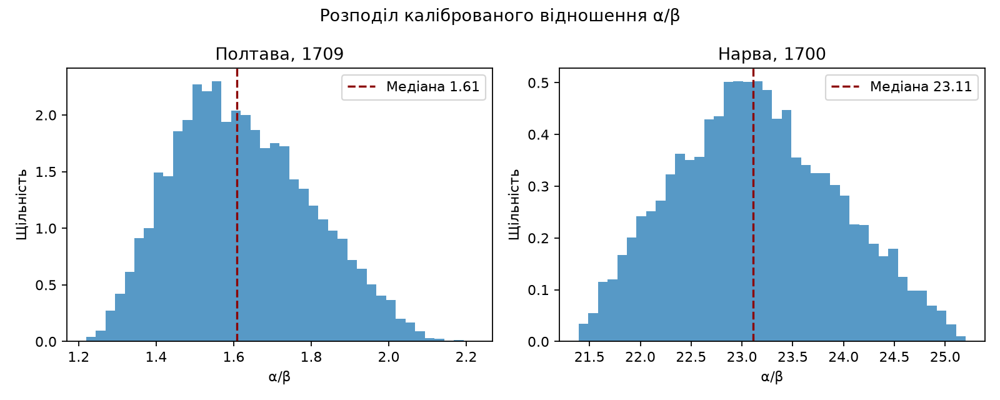
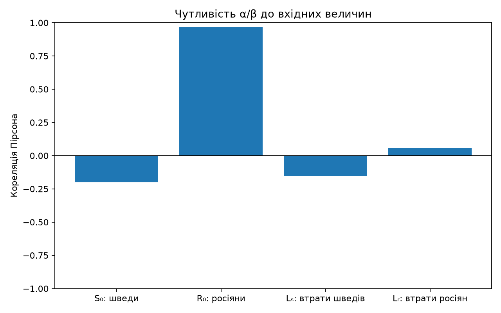
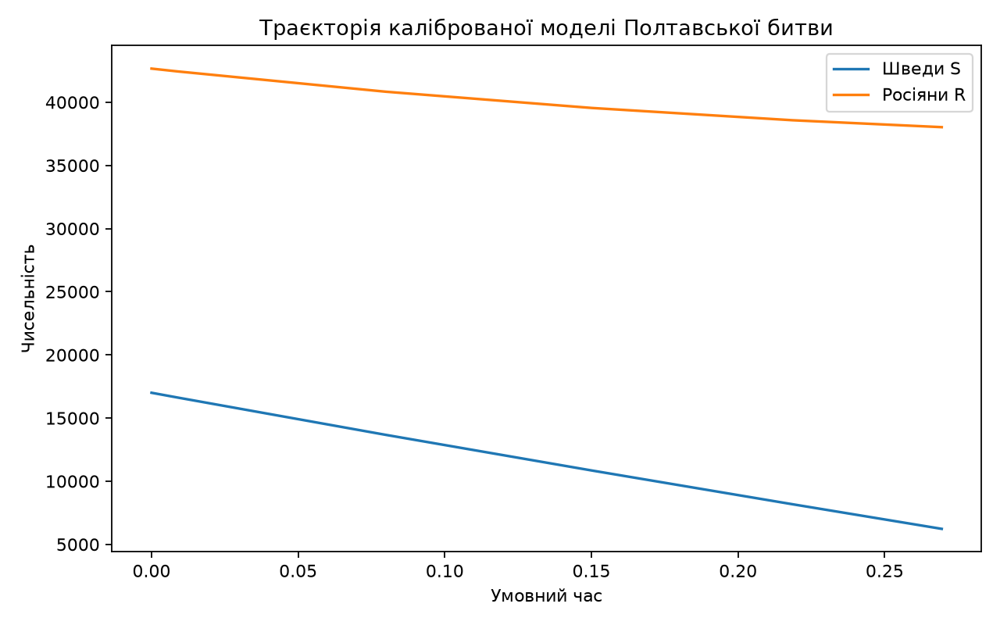

# Математична модель Полтавської битви (1709)

Науково-дослідницька робота (МАН): модель битви на основі закону квадратів Ланчестера, калібрування за історичними даними та оцінка невизначеності методом Монте-Карло.

**Статус: бета.** Реалізовано базову модель Ланчестера, артилерійський доданок, Монте-Карло, аналіз чутливості та зіставлення з Нарвою. Поки що модель не враховує фази бою, укріплення (`φ`) і нерегулярні війська; результати залежать від приблизних історичних оцінок.

## Що вже є

- `src/lanchester.py` — модель бою (закон квадратів): розв'язання системи ДР, зупинка бою при падінні однієї зі сторін до порога (в людях або в частці від початкової чисельності).
- `src/calibration.py` — відношення ефективностей α/β за початковим і кінцевим станом бою (через збережену величину αS² − βR²).
- `src/data_loader.py` — читання параметрів із `data/parameters.csv` у вигляді `{назва: (min, likely, max)}`.
- `src/montecarlo.py` — відтворювана вибірка параметрів і калібрування α/β для Полтави або Нарви.
- `src/sensitivity.py` — кореляція Пірсона чотирьох калібрувальних величин із α/β.
- `src/main.py` — повний запуск обчислень, графіків і таблиць.
- `tests/` — тести (`pytest`).

## Структура

```
data/     джерела, спостереження та параметри моделі
figures/  графіки, створені main.py
notes/    припущення, калібрування й обмеження
src/      код моделі та сценарій запуску
tables/   результати Монте-Карло, чутливість і підсумок
tests/    тести
```

## Дані

- `data/sources.csv` — перелік джерел.
- `data/observations.csv` — числа, які я бачив у тексті джерела, зі сторінкою за друкованою нумерацією книги.
- `data/parameters.csv` — параметри моделі з діапазонами `min / likely / max`, кожен прив'язаний до рядків `observations.csv`.

## Як запустити тести

```
python -m venv .venv
source .venv/bin/activate          # fish: source .venv/bin/activate.fish
pip install -r requirements.txt
python -m pytest
python src/main.py
```

Повний запуск використовує 10 000 симуляцій з фіксованим зерном 42. Кількість симуляцій та зерно можна змінити, наприклад: `python src/main.py --samples 5000 --seed 7`. Результати створюються в `figures/` і `tables/`; виконання не змінює початкові спостереження.

Скрипт формує розподіли α/β для Полтави й Нарви, кореляції чотирьох входів із α/β, а також траєкторію каліброваної моделі Полтави. Перенесення полтавського відношення на Нарву перевіряється через збережену величину Ланчестера; передумови та застереження наведені в [`notes/limitations.md`](notes/limitations.md).

### Результати Нарви й чутливості

За поточними параметрами медіана α/β становить **1,61 для Полтави** та **23,11 для Нарви** — приблизно у **14,37 раза більше** для Нарви. Полтавське відношення не переноситься: допустиму кінцеву чисельність шведів отримано в **0%** прогонів. За полтавського α/β втрати росіян у 10 000 осіб потребували б зменшення квадрата чисельності шведів більш ніж на їхній початковий квадрат чисельності. Імовірне пояснення для подальшої перевірки — укріплений російський табір під Нарвою; фактор укріплень `φ` у цій версії не моделюється.

Кореляції Пірсона з α/β у полтавській вибірці: `R0` **+0,97**, `S0` **−0,20**, `Ls` **−0,15**, `Lr` **+0,05**. Це чутливість до заданих діапазонів, а не незалежні причинні ефекти. Невелика кореляція `Lr` не означає, що російські втрати загалом мало впливають: у цій вибірці їхній діапазон вузький (4 500–4 635).

### Графіки

Готові графіки додаються до репозиторію, щоб їх можна було переглянути без запуску коду.







## Основні припущення й обмеження

Повний перелік — у `notes/assumptions.md`. Коротко:

- Закон квадратів Ланчестера, без фаз бою, укріплень, місцевості та моралі.
- Нерегулярні війська (козаки) у базовому сценарії не враховуються.
- Полтава калібрує α/β за своїми втратами; Нарва дає окреме порівняння перенесення, але не повністю незалежну перевірку.
- Час у моделі умовний: з втрат визначається лише відношення α/β, але не абсолютна швидкість бою.
- Артилерійський вогонь у ядрі моделі можна задати як додаткові сталі швидкості втрат; їхня ефективність окремо не оцінюється.
- Оцінки історичних чисел різняться, тому результати слід читати як порядок величини. Деталі — у `notes/limitations.md`.

Для формул калібрування див. [`notes/calibration.md`](notes/calibration.md), а для вихідних припущень — [`notes/assumptions.md`](notes/assumptions.md).
